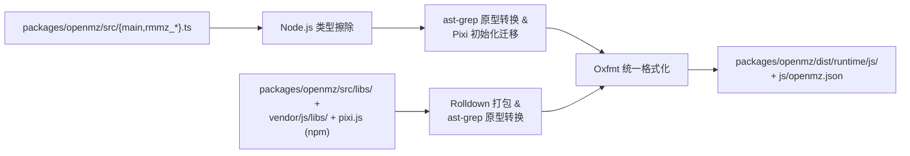

# OpenMZ

使用 TypeScript `class` 与 PixiJS 8 维护的 RPG Maker MZ 核心引擎，构建为原型式 JavaScript 运行时，兼容既有插件与工程数据。

[](https://github.com/enpitsuLin/openmz/releases)
[](https://nodejs.org/)
[](https://pixijs.com/)
[](./LICENSE)

**简体中文** | [English](./README_en.md)

[核心特性](#核心特性) · [快速开始](#快速开始) · [构建原理](#构建原理) · [更新器插件](#更新器插件) · [开发与测试](#开发与测试) · [目录结构](#目录结构)

---

## 核心特性

- **现代化源码维护**：引擎核心以 TypeScript 与 ES6 `class` 编写，类型直接维护在源码签名中，配套完整的数据库、存档、事件与宿主环境声明（`packages/openmz/src/data.d.ts`、`packages/openmz/src/environment.d.ts`）。
- **PixiJS 8 渲染内核**：从 npm 打包 PixiJS 8 并在构建期转为原型式全局 `PIXI`，升级底层渲染能力的同时保持对既有插件的调用兼容。
- **传统插件原型兼容**：通过 ast-grep 将引擎与 PixiJS 的类转换为平铺函数、原型方法与属性描述符，完整支持 `prototype` 覆写、`.call(this)` 与 `initialize` 链式扩展。
- **零降级现代语法产物**：基于 Node.js 原生类型擦除、Rolldown 与 Oxfmt 构建，保留 `async/await`、箭头函数、可选链、解构与迭代语法，不注入 ES5 降级辅助代码。
- **解耦的插件子包生态**：采用 pnpm workspace 组织核心引擎、内部构建工具与独立插件子包，插件独立构建与发版；官方提供 `OpenMzUpdater` 插件，支持在 NW.js 环境中自动检测新版本、校验 SHA-256、自动备份旧文件并在失败时完整回滚。

## 快速开始

### 在 RPG Maker MZ 工程中使用

#### 方式一：使用更新器插件（推荐）

1. 从 [GitHub Releases](https://github.com/enpitsuLin/openmz/releases) 的 `plugin/openmz-updater@v*` 发布页下载 `OpenMzUpdater.js`（或自行构建 `plugins/openmz-updater/dist/OpenMzUpdater.js`），放入工程的 `js/plugins/` 目录。
2. 在 RPG Maker MZ 插件管理器中启用 `OpenMzUpdater`，并将**更新清单地址**配置为：
   - 最新正式版：`https://github.com/enpitsuLin/openmz/releases/latest/download/manifest.json`
   - 指定版本：`https://github.com/enpitsuLin/openmz/releases/download/<tag>/manifest.json`
3. 在 NW.js 中启动游戏，首次进入标题画面时将自动检查并提示更新，安装完成后重启生效。

#### 方式二：手动安装运行时

从 Release 下载核心压缩包，或从源码构建后，将 `packages/openmz/dist/runtime/js/` 中的全部内容复制到 RPG Maker MZ 工程的 `js/` 目录。

> [!NOTE]
> 运行时产物不包含 `plugins.js` 和 `plugins/` 目录，工程原有的插件配置、数据库、素材与存档均保持原样。

### 从源码构建

**环境要求**：Node.js 24+、pnpm

```sh
pnpm install
pnpm build
```

构建产物按子包输出至各自的 `dist/`：

| 产物路径                           | 说明                                                                        |
| ---------------------------------- | --------------------------------------------------------------------------- |
| `packages/openmz/dist/runtime/js/` | 核心脚本、原型式 PixiJS 8、其他运行库依赖与 `openmz.json`                   |
| `packages/openmz/dist/release/`    | 执行 `pnpm --filter openmz run pack` 生成的核心发布压缩包与 `manifest.json` |
| `plugins/<plugin-dir>/dist/*.js`   | 各插件子包独立构建生成的可安装插件脚本（如 `OpenMzUpdater.js`）             |

## 构建原理

OpenMZ 通过四阶段管线将 TypeScript 源码与 npm 依赖编译为兼容传统插件生态的原型式运行时：



### 核心转换规则

1. **类型擦除与字段顺序**：使用 Node.js 擦除 `packages/openmz/src/{main,rmmz_*}.ts` 的类型；`declare` 字段不生成实例赋值语句，确保派生类不会在父构造后重置由 `initialize` 写入的状态。
2. **运行库合并与打包**：按文件名合并 `vendor/js/libs/` 与 `packages/openmz/src/libs/`（同名文件以 `src/libs/` 优先），通过 `libraryProcessors` 按文件定制处理策略。`pixi.js` 使用 Rolldown 从 npm 打包为浏览器全局 `PIXI` 并保留命名空间外壳、关闭严格模式指令，其余运行库默认原样输出。
3. **平铺原型式类转换**：`packages/build-utils` 中的 ast-grep 转换器将 `rmmz_*.ts` 与 `pixi.js` 中的 `class` 转换为平铺构造函数、原型方法及属性描述符，不为单个类生成 IIFE 或注入 `"use strict"`；类表达式使用唯一内部绑定以保留构造函数名称与自引用。`main.ts` 仅擦除类型，输出保留 `class Main`。
4. **PixiJS 构造器兼容**：将继承自 PixiJS 的引擎类（如 `Sprite`、`TilingSprite`、`Window`、`Stage`、`Point`、`Rectangle`、`Tilemap`、`ScreenSprite`、`WindowLayer`、`Weather`、`ColorFilter`、`Sprite_Animation` 等）中的 PixiJS 父类初始化逻辑移入 `initialize`，使普通 `new` 构造与旧插件的 `initialize.call(this)` 都在同一 `this` 实例上仅初始化一次。
5. **非严格语义与现代语法**：派生构造使用 `.call` / `.apply` 而非 `Reflect.construct`；原型方法可枚举、访问器不可枚举，与原版 MZ 语义一致；保留 `async/await`、箭头函数、可选链、解构与迭代，不做 ES5 降级。
6. **版本元数据与统一格式化**：生成 `js/openmz.json` 记录引擎版本、PixiJS 版本与运行时格式；所有文本产物（含发布清单）在写入前通过 Oxfmt API 按 `printWidth: 120` 统一格式化，WASM 等二进制文件按原始字节复制。

## 更新器插件

### 使用与安全保障

在 NW.js 环境中首次进入标题画面时，`OpenMzUpdater` 会在后台拉取清单并与工程的 `js/openmz.json` 比对语义版本：

- **非侵入式检查**：浏览器环境、清单地址留空、版本相同或目标版本更旧时均不弹窗提示；插件本身保持启用状态，且永不改写 `js/plugins.js`，也拒绝安装包含 `js/plugins/` 路径的更新包。
- **安装前严格校验**：依次校验压缩包字节大小、SHA-256 摘要、条目路径合法性及包内版本元数据。
- **自动备份与回滚**：替换前将原有文件备份至 `js_backup/<时间戳>/`；安装过程中任意步骤失败，都会自动还原已写入的文件与 `js/openmz.json`。
- **手动恢复备份**：如需回退，将对应备份目录中的 `js/` 文件覆盖回工程；若该次更新是首次从原版 MZ 升级到 OpenMZ，还需删除 `js/openmz.json`。

### 发布清单协议

发布清单当前使用 `schemaVersion: 1`，结构定义位于 [`packages/release-spec/src/index.ts`](./packages/release-spec/src/index.ts)：

| 字段             | 类型     | 说明                             |
| ---------------- | -------- | -------------------------------- |
| `schemaVersion`  | `1`      | 清单协议版本号                   |
| `name`           | `string` | 固定为 `OpenMZ`                  |
| `version`        | `string` | 引擎语义版本号                   |
| `format`         | `string` | 运行时格式，固定为 `prototype`   |
| `pixiVersion`    | `string` | 打包的 PixiJS 版本号             |
| `archive.url`    | `string` | 核心 `tar.gz` 地址，支持相对路径 |
| `archive.size`   | `number` | 压缩包字节数（必填）             |
| `archive.sha256` | `string` | 压缩包 SHA-256 校验值（必填）    |

> [!TIP]
> 当 `archive.url` 为相对路径时，解析基准为清单重定向链中原站最后一个地址，天然兼容 GitHub Releases 的标签跳转与 CDN 分发。

### 插件结构与本地调试

每个插件都是 `plugins/` 下的独立 workspace 子包（目录使用 kebab-case，构建产物输出大驼峰插件文件名）：

```text
plugins/
└── openmz-updater/
    ├── package.json            # 独立版本号、依赖与脚本
    ├── scripts/build.ts        # 调用 @openmz-internal/build-utils 输出 dist/OpenMzUpdater.js
    ├── src/
    │   ├── index.ts            # 插件入口与中英文元数据声明
    │   ├── core.ts             # 更新编排核心
    │   ├── manifest.ts         # 清单拉取与校验
    │   ├── package-validator.ts # 压缩包路径与版本校验
    │   ├── installer.ts        # 备份、安装与回滚
    │   ├── transport.ts        # 网络下载与重定向处理
    │   ├── tar.ts              # tar.gz 解包
    │   ├── errors.ts / types.ts # 错误类型与公共类型
    │   └── ui.ts & ui/         # 标题界面与多语言交互
    └── __test__/               # Vitest 单元测试
```

单独构建插件或启动本地更新源进行联调：

```sh
# 构建全部或指定插件
pnpm --filter './plugins/*' build
pnpm --filter ./plugins/openmz-updater build

# 构建核心发布包并启动本地更新源（默认 http://127.0.0.1:4173/manifest.json）
pnpm --filter openmz serve:manifest

# 指定端口或跳过构建直接使用已有 packages/openmz/dist/release/
pnpm --filter openmz serve:manifest --port 8080 --no-build
```

## 开发与测试

### 常用命令

| 命令                                | 说明                                                   |
| ----------------------------------- | ------------------------------------------------------ |
| `pnpm build`                        | 递归构建 OpenMZ 核心运行时与全部插件                   |
| `pnpm lint` / `pnpm lint:fix`       | 使用 Oxlint 检查源码（警告视为错误）或执行安全自动修复 |
| `pnpm format` / `pnpm format:check` | 使用 Oxfmt 格式化源码或检查格式                        |
| `pnpm typecheck`                    | 使用严格模式检查引擎、内部包、插件与测试的 TypeScript  |
| `pnpm test`                         | 运行全部 Vitest 测试项目                               |
| `pnpm test:unit`                    | 递归运行各子包的 Node.js 单元测试                      |

单包操作直接通过 `pnpm --filter` 执行，例如：

- `pnpm --filter openmz build` / `pnpm --filter openmz run pack` / `pnpm --filter openmz serve:manifest`
- `pnpm --filter openmz test:plugin-compat`
- `pnpm --filter ./plugins/openmz-updater build`

### 测试体系

根 `vitest.config.ts` 聚合各子包的测试项目：

| 项目             | 运行环境            | 覆盖范围                                                      |
| ---------------- | ------------------- | ------------------------------------------------------------- |
| `build-utils`    | Node.js             | AST 类转原型、Pixi 初始化恢复等公共转换工具                   |
| `openmz`         | Node.js             | 引擎类型擦除、原型结构与完整运行时构建                        |
| `openmz-updater` | Node.js             | 清单解析、压缩包校验、传输重试、安装回滚与标题 UI 集成        |
| `plugin-compat`  | Playwright Chromium | 使用最小工程夹具对照原版 MZ 与构建产物测试插件、UI 与渲染表现 |

首次运行浏览器兼容性测试前，需先安装 Chromium：

```sh
pnpm --filter openmz exec playwright install chromium
```

### 代码规范与发布流程

- **代码风格**：由 `.oxlintrc.json` 与 `.oxfmtrc.json` 统一约束。引擎源码（`packages/openmz/src/*.ts`）保留四空格缩进与双引号，内部包、工具链、插件与测试代码采用双空格缩进与单引号；`vendor/`、兼容性夹具与各包 `dist/` 不参与源码检查与 CLI 格式化。
- **核心自动化发布**：推送 `v*` 标签（或手动触发 [Release OpenMZ Core 工作流](./.github/workflows/release-core.yml)）后，GitHub Actions 会自动验证并执行 `pnpm --filter openmz run pack`，将核心压缩包与 `manifest.json` 上传至 GitHub Release。
- **插件独立发布**：推送 `plugin/<插件目录>@v<版本>` 标签（例如 `plugin/openmz-updater@v1.0.0`，或手动触发 [Release Plugin 工作流](./.github/workflows/release-plugin.yml)）后，GitHub Actions 会校验对应插件 `package.json` 版本、运行测试并构建，将 `plugins/<插件目录>/dist/*.js` 发布为独立的 GitHub Release。

## 目录结构

```text
.
├── pnpm-workspace.yaml
├── packages/
│   ├── openmz/                 # OpenMZ 核心引擎包
│   │   ├── src/                # 引擎 TypeScript 源码、数据库协议 (data.d.ts)、宿主类型与 libs/
│   │   ├── scripts/            # CLI、类型擦除、运行时构建、发布打包与本地更新源
│   │   ├── tests/              # unit/ 与 plugin-compat/ 浏览器兼容性测试
│   │   └── dist/               # 核心运行时 (runtime/) 与发布包 (release/)
│   ├── build-utils/            # 内部公共包：AST 原型转换、Rolldown 打包、Oxfmt 格式化与插件构建器
│   └── release-spec/           # 内部公共包：发布清单、版本比较与 tar 归档协议
├── plugins/
│   └── openmz-updater/         # 独立插件子包：输出 dist/OpenMzUpdater.js
└── vendor/js/                  # 原版 RPG Maker MZ 运行时参考与默认运行库（只读）
```

## 许可证

[MIT](./LICENSE) © enpitsulin
