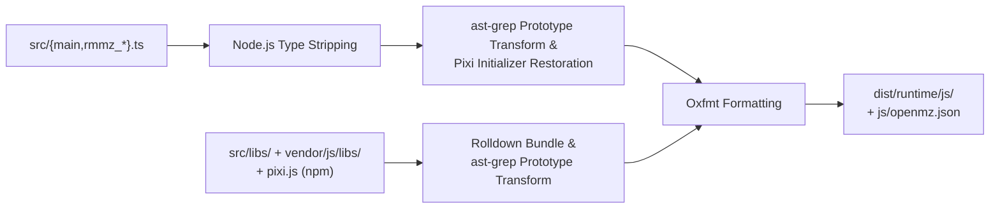

# OpenMZ

RPG Maker MZ core engine maintained with TypeScript `class` syntax and PixiJS 8, compiled to a prototype-based JavaScript runtime compatible with existing plugins and project data.

[](https://github.com/enpitsuLin/openmz/releases)
[](https://nodejs.org/)
[](https://pixijs.com/)
[](./LICENSE)

[简体中文](./README.md) | **English**

[Highlights](#highlights) · [Quick Start](#quick-start) · [Build Pipeline](#build-pipeline) · [Updater Plugin](#updater-plugin) · [Development & Testing](#development--testing) · [Project Structure](#project-structure)

---

## Highlights

- **Modern TypeScript Source**: Core engine authored with TypeScript and ES6 `class` declarations, keeping types inline with full database, save, event, and host environment definitions (`src/data.d.ts`, `src/environment.d.ts`).
- **PixiJS 8 Rendering Core**: Bundles PixiJS 8 from npm and transforms it into a prototype-based global `PIXI`, upgrading the renderer while preserving compatibility with legacy plugin calls.
- **Legacy Plugin Compatibility**: Converts engine and PixiJS classes via ast-grep into flat constructor functions, prototype methods, and property descriptors, supporting `prototype` overrides, `.call(this)`, and `initialize` chaining.
- **No ES5 Downleveling**: Built with native Node.js type stripping, Rolldown, and Oxfmt; preserves native `async/await`, arrow functions, optional chaining, destructuring, and iteration without emitting downlevel helpers.
- **Safe Built-in Updater**: Ships with `OpenMzUpdater`, supporting automatic update checks in NW.js, SHA-256 verification, automatic backups, and full rollback on installation failure.

## Quick Start

### Using in an RPG Maker MZ Project

#### Option 1: Install via Updater Plugin (Recommended)

1. Download `OpenMzUpdater.js` from [GitHub Releases](https://github.com/enpitsuLin/openmz/releases) (or build `dist/plugins/OpenMzUpdater.js` from source) and copy it into your project's `js/plugins/` directory.
2. Enable `OpenMzUpdater` in the RPG Maker MZ Plugin Manager and configure **Manifest URL**:
   - Latest release: `https://github.com/enpitsuLin/openmz/releases/latest/download/manifest.json`
   - Pinned release: `https://github.com/enpitsuLin/openmz/releases/download/<tag>/manifest.json`
3. Launch the game in NW.js. When the title scene first opens, the updater checks for updates in the background and prompts to install. Restart the game after installation completes.

#### Option 2: Manual Runtime Installation

Download the core archive from Releases or build from source, then copy all contents of `dist/runtime/js/` into your RPG Maker MZ project's `js/` directory.

> [!NOTE]
> The runtime output excludes `plugins.js` and `plugins/`. Your existing plugin configuration, database, assets, and save files remain untouched.

### Building from Source

**Requirements**: Node.js 24+, pnpm

```sh
pnpm install
pnpm build
```

Build outputs are written to `dist/`:

| Output Path         | Description                                                                    |
| ------------------- | ------------------------------------------------------------------------------ |
| `dist/runtime/js/`  | Core engine scripts, prototype-based PixiJS 8, runtime libs, and `openmz.json` |
| `dist/plugins/*.js` | Standalone installable scripts built for each plugin directory                 |
| `dist/release/`     | Release archive, manifest, and plugins generated by `pnpm openmz pack`         |

## Build Pipeline

OpenMZ compiles TypeScript sources and npm dependencies into a prototype-based runtime through a four-stage pipeline:



### Key Transformation Rules

1. **Type Stripping & Field Ordering**: Node.js strips types from `src/{main,rmmz_*}.ts`. `declare` fields emit no assignments, ensuring derived classes do not overwrite state initialized by `initialize`.
2. **Library Merging & Bundling**: Merges `vendor/js/libs/` and `src/libs/` by filename (`src/libs/` takes precedence), with per-file customization via `libraryProcessors`. `pixi.js` is bundled from npm via Rolldown into global `PIXI` with its namespace wrapper preserved and strict mode disabled; other libraries are emitted as-is by default.
3. **Flat Prototype Class Transform**: ast-grep converts classes in `rmmz_*.ts` and `pixi.js` into flat constructor functions, prototype methods, and property descriptors without wrapping classes in IIFEs or injecting `"use strict"`. Class expressions use unique internal bindings to preserve constructor names and self-references. `main.ts` is type-stripped only, retaining `class Main`.
4. **PixiJS Constructor Compatibility**: Moves PixiJS parent constructor initialization for PixiJS-extending engine classes (`Sprite`, `TilingSprite`, `Window`, `Stage`, `Point`, `Rectangle`, `Tilemap`, `ScreenSprite`, `WindowLayer`, `Weather`, `ColorFilter`, `Sprite_Animation`, etc.) into `initialize`, so both standard `new` calls and legacy `initialize.call(this)` initialize the same `this` instance exactly once.
5. **Non-Strict Semantics & Modern Syntax**: Derived constructors call parents via `.call` / `.apply` rather than `Reflect.construct`. Prototype methods are enumerable and accessors are non-enumerable, matching vanilla MZ semantics. Modern syntax (`async/await`, arrow functions, optional chaining, destructuring, iteration) is preserved without ES5 downleveling.
6. **Metadata & Unified Formatting**: Emits `js/openmz.json` recording engine version, PixiJS version, and runtime format. All text outputs (including release manifests) are formatted via the Oxfmt API with `printWidth: 120`; binary files such as WASM are copied byte-for-byte.

## Updater Plugin

### Usage & Safety Guarantees

When the title scene first opens in NW.js, `OpenMzUpdater` fetches the configured manifest in the background and compares its semantic version against `js/openmz.json`:

- **Non-Intrusive Checks**: Skips prompts in browser environments, when Manifest URL is empty, or when the installed version is already up to date or newer. The plugin remains enabled, never modifies `js/plugins.js`, and rejects archives containing `js/plugins/` entries.
- **Pre-Install Verification**: Validates archive byte size, SHA-256 digest, entry path safety, and in-archive version metadata before touching project files.
- **Automatic Backup & Rollback**: Backs up replaced files to `js_backup/<timestamp>/` prior to installation. Any failure automatically restores modified files and `js/openmz.json`.
- **Manual Restore**: Copy the `js/` files from the corresponding backup directory back into your project. If that update was your first migration from vanilla MZ to OpenMZ, also delete `js/openmz.json`.

### Release Manifest Schema

Release manifests use `schemaVersion: 1`, defined in [`shared/engine-release.ts`](./shared/engine-release.ts):

| Field            | Type     | Description                                 |
| ---------------- | -------- | ------------------------------------------- |
| `schemaVersion`  | `1`      | Manifest schema version                     |
| `name`           | `string` | Always `OpenMZ`                             |
| `version`        | `string` | Engine semantic version                     |
| `format`         | `string` | Runtime format, always `prototype`          |
| `pixiVersion`    | `string` | Bundled PixiJS version                      |
| `archive.url`    | `string` | Core `tar.gz` URL (supports relative paths) |
| `archive.size`   | `number` | Archive size in bytes (required)            |
| `archive.sha256` | `string` | Archive SHA-256 checksum (required)         |

> [!TIP]
> Relative `archive.url` values are resolved against the final same-origin URL in the manifest redirect chain, supporting GitHub Releases tag redirects and CDN downloads out of the box.

### Plugin Layout & Local Debugging

Each plugin lives in its own subdirectory under `plugins/` with `index.ts` as its entry point, preserving both English and Chinese RPG Maker plugin headers:

```text
plugins/
└── OpenMzUpdater/
    ├── index.ts                # Plugin entry point & metadata headers
    ├── core.ts                 # Update orchestration
    ├── manifest.ts             # Manifest fetching & validation
    ├── package-validator.ts    # Archive path & version checks
    ├── installer.ts            # Backup, installation & rollback
    ├── transport.ts            # HTTP download & redirect handling
    ├── tar.ts                  # tar.gz extraction
    ├── errors.ts / types.ts    # Error definitions & shared types
    ├── ui.ts & ui/             # Title scene UI & i18n
    └── __test__/               # Vitest unit tests
```

Build individual plugins or run a local manifest server for testing:

```sh
# Build all plugins or a specific plugin
pnpm openmz build plugin
pnpm openmz build plugin OpenMzUpdater

# Pack a release and serve locally (default: http://127.0.0.1:4173/manifest.json)
pnpm serve:manifest

# Custom port or reuse existing dist/release/ without rebuilding
pnpm serve:manifest --port 8080 --no-build
```

## Development & Testing

### Common Commands

| Command                             | Description                                                                  |
| ----------------------------------- | ---------------------------------------------------------------------------- |
| `pnpm openmz build`                 | Build full runtime and all plugins (shorthand: `pnpm build`)                 |
| `pnpm openmz build runtime`         | Build engine core, PixiJS 8, and runtime libraries only                      |
| `pnpm openmz build plugin [name]`   | Build all plugins or a specific plugin                                       |
| `pnpm openmz pack [--version <v>]`  | Package runtime archive, release manifest, and all plugins                   |
| `pnpm lint` / `pnpm lint:fix`       | Lint maintained sources with Oxlint (warnings fail) or apply safe auto-fixes |
| `pnpm format` / `pnpm format:check` | Format maintained files with Oxfmt or verify formatting                      |
| `pnpm typecheck`                    | Strictly type-check engine, scripts, plugins, and tests                      |
| `pnpm test`                         | Run all Vitest projects                                                      |
| `pnpm test:unit`                    | Run Node.js unit tests only                                                  |
| `pnpm test:plugin-compat`           | Run Playwright Chromium plugin compatibility tests only                      |
| `pnpm serve:manifest`               | Build and serve a local release manifest                                     |

### Test Suite

Vitest runs two configured projects:

| Project         | Environment         | Coverage                                                                        |
| --------------- | ------------------- | ------------------------------------------------------------------------------- |
| `unit`          | Node.js             | AST transforms, prototype output, type stripping, packaging, updater & rollback |
| `plugin-compat` | Playwright Chromium | Compares vanilla MZ and built runtime across plugins, UI, scenes, and rendering |

Install Chromium before running browser compatibility tests for the first time:

```sh
pnpm exec playwright install chromium
```

### Code Style & Release Workflow

- **Formatting & Linting**: Configured in `.oxlintrc.json` and `.oxfmtrc.json`. Engine sources (`src/*.ts`) use 4-space indentation and double quotes; tooling, plugins, and tests use 2-space indentation and single quotes. `vendor/`, compatibility fixtures, and `dist/` are excluded from source linting and CLI formatting.
- **Automated Releases**: Pushing a `v*` tag (or manually triggering the [Release workflow](./.github/workflows/release.yml)) runs `lint`, `format:check`, `typecheck`, `test:unit`, `test:plugin-compat`, and `pnpm openmz pack`, then publishes the archive, manifest, and plugins from `dist/release/` to GitHub Releases.

## Project Structure

```text
.
├── src/                   # Engine TypeScript sources, database types (data.d.ts), and host types (environment.d.ts)
│   └── libs/              # Runtime library overrides and PixiJS 8 npm bundle entry
├── plugins/               # Plugin source directories (each with index.ts and __test__/)
├── shared/                # Shared release manifest and versioning protocol
├── scripts/               # CLI, type stripping, AST prototype transforms, packaging, and local manifest server
├── tests/
│   ├── unit/              # Node.js unit tests for engine builds and transforms
│   └── plugin-compat/     # Browser plugin compatibility tests and minimal fixtures/ project
├── vendor/js/             # Vanilla RPG Maker MZ runtime reference and default libs (read-only)
└── dist/                  # Generated runtime, plugins, and release artifacts
```

## License

[MIT](./LICENSE) © enpitsulin
