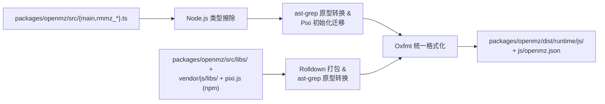

# 构建原理与转换规则

[← 返回首页](../README.md) · **简体中文** | [English](./architecture_en.md)

OpenMZ 通过四阶段管线将 TypeScript 源码与 npm 依赖编译为兼容传统插件生态的原型式运行时：

## 核心转换规则

1. **类型擦除与字段顺序**：使用 Node.js 擦除 `packages/openmz/src/{main,rmmz_*}.ts` 的类型；`declare` 字段不生成实例赋值语句，确保派生类不会在父构造后重置由 `initialize` 写入的状态。
2. **运行库合并与打包**：按文件名合并 `vendor/js/libs/` 与 `packages/openmz/src/libs/`（同名文件以 `src/libs/` 优先），通过 `libraryProcessors` 按文件定制处理策略。`pixi.js` 使用 Rolldown 从 npm 打包为浏览器全局 `PIXI` 并保留命名空间外壳、关闭严格模式指令，其余运行库默认原样输出。
3. **平铺原型式类转换**：`packages/build-utils` 中的 ast-grep 转换器将 `rmmz_*.ts` 与 `pixi.js` 中的 `class` 转换为平铺构造函数、原型方法及属性描述符，不为单个类生成 IIFE 或注入 `"use strict"`；类表达式使用唯一内部绑定以保留构造函数名称与自引用。`main.ts` 仅擦除类型，输出保留 `class Main`。
4. **PixiJS 构造器兼容**：将继承自 PixiJS 的引擎类（如 `Sprite`、`TilingSprite`、`Window`、`Stage`、`Point`、`Rectangle`、`Tilemap`、`ScreenSprite`、`WindowLayer`、`Weather`、`ColorFilter`、`Sprite_Animation` 等）中的 PixiJS 父类初始化逻辑移入 `initialize`，使普通 `new` 构造与旧插件的 `initialize.call(this)` 都在同一 `this` 实例上仅初始化一次。
5. **非严格语义与现代语法**：派生构造使用 `.call` / `.apply` 而非 `Reflect.construct`；原型方法可枚举、访问器不可枚举，与原版 MZ 语义一致；保留 `async/await`、箭头函数、可选链、解构与迭代，不做 ES5 降级。
6. **版本元数据与统一格式化**：生成 `js/openmz.json` 记录引擎版本、PixiJS 版本与运行时格式；所有文本产物（含发布清单）在写入前通过 Oxfmt API 按 `printWidth: 120` 统一格式化，WASM 等二进制文件按原始字节复制。
