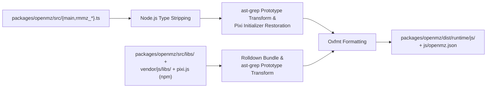

# Build Pipeline & Transformation Rules

[← Back to Home](../README_en.md) · [简体中文](./architecture.md) | **English**

OpenMZ compiles TypeScript sources and npm dependencies into a prototype-based runtime through a four-stage pipeline:

## Key Transformation Rules

1. **Type Stripping & Field Ordering**: Node.js strips types from `packages/openmz/src/{main,rmmz_*}.ts`. `declare` fields emit no assignments, ensuring derived classes do not overwrite state initialized by `initialize`.
2. **Library Merging & Bundling**: Merges `vendor/js/libs/` and `packages/openmz/src/libs/` by filename (`src/libs/` takes precedence), with per-file customization via `libraryProcessors`. `pixi.js` is bundled from npm via Rolldown into global `PIXI` with its namespace wrapper preserved and strict mode disabled; other libraries are emitted as-is by default.
3. **Flat Prototype Class Transform**: The ast-grep transformer in `packages/build-utils` converts classes in `rmmz_*.ts` and `pixi.js` into flat constructor functions, prototype methods, and property descriptors without wrapping classes in IIFEs or injecting `"use strict"`. Class expressions use unique internal bindings to preserve constructor names and self-references. `main.ts` is type-stripped only, retaining `class Main`.
4. **PixiJS Constructor Compatibility**: Moves PixiJS parent constructor initialization for PixiJS-extending engine classes (`Sprite`, `TilingSprite`, `Window`, `Stage`, `Point`, `Rectangle`, `Tilemap`, `ScreenSprite`, `WindowLayer`, `Weather`, `ColorFilter`, `Sprite_Animation`, etc.) into `initialize`, so both standard `new` calls and legacy `initialize.call(this)` initialize the same `this` instance exactly once.
5. **Non-Strict Semantics & Modern Syntax**: Derived constructors call parents via `.call` / `.apply` rather than `Reflect.construct`. Prototype methods are enumerable and accessors are non-enumerable, matching vanilla MZ semantics. Modern syntax (`async/await`, arrow functions, optional chaining, destructuring, iteration) is preserved without ES5 downleveling.
6. **Metadata & Unified Formatting**: Emits `js/openmz.json` recording engine version, PixiJS version, and runtime format. All text outputs (including release manifests) are formatted via the Oxfmt API with `printWidth: 120`; binary files such as WASM are copied byte-for-byte.
